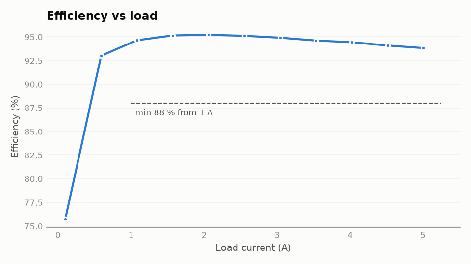

# power-electronics-test-automation

[](https://github.com/Mula8641/power-electronics-test-automation/actions/workflows/ci.yml)

Automated bench test for a 12 V → 5 V buck converter. It drives a power supply, an electronic
load and a multimeter over SCPI (PyVISA), sweeps load current from 0.1 A to 5 A, logs every
point to CSV, and writes a self-contained HTML report with a **PASS / FAIL / ABORTED** verdict.

It runs end to end with no hardware: the built-in simulated bench couples the three instruments
through a loss model of the converter, so efficiency and regulation behave like a real unit.



## Run it

```bash
pip install -e ".[dev]"
pe-bench specs/buck_5v.yaml --sim --out results
```

Outputs land in `results/`: `<name>.csv`, `<name>.html` (plots embedded) and the PNGs.
The exit code is `0` pass, `1` fail, `2` aborted, so it drops straight into CI.

| Spec | What it demonstrates | Result | Report |
|---|---|---|---|
| `specs/buck_5v.yaml` | Healthy unit, realistic limits | PASS | [html](docs/examples/buck_5v_efficiency.html) |
| `specs/buck_5v_marginal.yaml` | Same unit, tight limits (95 % efficiency, 0.2 % regulation) | FAIL, all 3 checks | [html](docs/examples/buck_5v_efficiency_marginal.html) |
| `specs/buck_5v_overcurrent.yaml` | Input current limit set to 1.2 A | ABORTED at 3.04 A, partial data kept | [html](docs/examples/buck_5v_overcurrent_trip.html) |

## What is checked

| Check | Rule (from the YAML spec) |
|---|---|
| Worst-case Vout error | every point within ±`vout_tolerance_pct` of nominal |
| Min efficiency | lowest efficiency at loads ≥ `efficiency_from_load_a` stays ≥ `min_efficiency_pct` |
| Load regulation | (Vout at light load − Vout at full load) / Vout at light load ≤ limit |

Efficiency is `Vout·Iout / Vin·Iin` from averaged readings. Light-load points are deliberately
excluded from the efficiency limit: every buck converter is inefficient at 0.1 A because fixed
losses dominate, and the spec says so explicitly instead of hiding the dip.

## Design

```
src/pe_bench/
├── config/       spec.py        YAML → frozen dataclasses; unknown keys are rejected
├── instruments/  scpi.py        write/query + error-queue check after every command
│                 psu.py eload.py dmm.py    one thin driver per instrument
├── core/         bench.py       open instruments; energized() guarantees outputs go off
│                 sweep.py       one measurement point, then a generator over the sweep
│                 analysis.py    derived power, loss, efficiency, regulation
│                 verdict.py     checks → PASS / FAIL / ABORTED
│                 runner.py      orchestration: sweep → analysis → verdict
├── reporting/    plots.py html.py artifacts.py
├── sim/          converter.py   buck loss model   bench.py   simulated VISA resources
└── cli.py
```

Decisions worth knowing about:

- **Same code for simulation and hardware.** Drivers only need `write()` and `query()`.
  `--sim` passes a `SimulatedBench`; without it the CLI uses `pyvisa.ResourceManager()` and the
  addresses in the spec (e.g. `TCPIP0::192.168.1.20::INSTR`).
- **Safe teardown.** `energized()` disables the load, then the supply, in nested `finally`
  blocks, so a crash or a tripped supply never leaves the output on. A test asserts this.
- **Errors are read, not assumed.** Every command is followed by `SYST:ERR?`. A queued
  instrument error raises `InstrumentError`, the sweep stops, the report says why, and the
  points already captured are kept.
- **Deterministic simulation.** Measurement noise is seeded, so runs and tests are repeatable.

## Tests and CI

```bash
pytest --cov=pe_bench     # 27 tests, 99 % coverage
ruff check . && ruff format --check .
```

Covered: the converter physics (efficiency peaks mid-load, output droops linearly), SCPI error
handling, the overcurrent trip, teardown after a failure, the analysis arithmetic on hand-computed
numbers, all three end-to-end outcomes, CLI exit codes, and the report content.
The one uncovered branch is the real-hardware path in `cli.py`.

GitHub Actions runs lint and tests on Python 3.11 to 3.13, then runs the three demo specs and
uploads the generated reports as a downloadable artifact.

## Limits, stated plainly

- Validated against the simulator only. The instruments' SCPI dialects here (`VOLT`, `CURR`,
  `OUTP`, `MEAS:VOLT?`, …) are common but not any one vendor's; real units will need command
  tweaks in `instruments/`.
- The loss model is a first-order approximation, not a circuit simulation. It has no ripple,
  transients, thermal drift or instrument accuracy.
- Settling is a fixed delay (`settle_s`), not a convergence check. It is `0` in simulation.

## Ideas for extension

Output ripple capture with a scope driver, a line-regulation sweep (Vin), thermal derating,
and a settling check that waits until consecutive readings agree within a tolerance.
